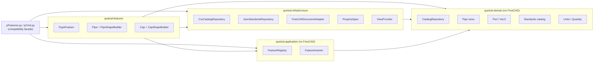
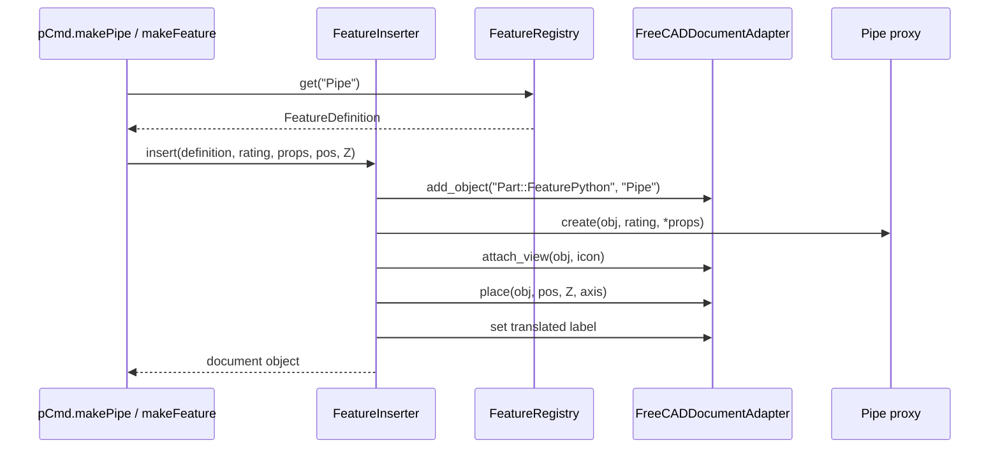

# Quetzal architecture

This document describes the architecture introduced by the SOLID refactor and
the compatibility rules that keep existing FreeCAD documents and macros
working.

## Goals

1. **Separate business rules from FreeCAD.** Catalogue parsing, nominal sizes
   and port maths must be testable without a running FreeCAD instance.
2. **Make features data-driven.** Adding a fitting should be a matter of
   declaring a feature definition, not editing several `if/elif` chains.
3. **Keep the public API stable.** `pFeatures.Pipe`, `pCmd.makePipe`,
   `pCmd.doPipes`, command names, property names and the `PType` values are
   part of the contract with saved documents, forms and user macros.
4. **Make the workbench testable headlessly.** FreeCADCmd has no
   `FreeCADGui.Selection` and no main window, so the core must degrade
   gracefully instead of raising `AttributeError`.

## Layers

**Dependency rule:** arrows point inwards. `quetzal.domain` imports nothing
from the rest of the workbench. `quetzal.application` only depends on the
domain and on protocols. FreeCAD-specific code lives in
`quetzal.infrastructure` and `quetzal.features`.

### Domain

| Module | Responsibility |
| --- | --- |
| `quetzal/domain/catalog.py` | `CatalogTable`, `CatalogRepository` protocol, CSV and in-memory adapters, safe file resolution. |
| `quetzal/domain/pipe_sizes.py` | Single immutable outside-diameter table and lookup helpers. |
| `quetzal/domain/ports.py` | `Vec3`, `Port`, nearest-port calculation. |
| `quetzal/domain/units.py` | `Unit`, `Quantity` and type-safe conversions to canonical mm, kg, bar, ° and N·m. |
| `quetzal/domain/nominal_sizes.py` | DN/NPS identities following ISO 6708 (a lookup, not a length conversion). |
| `quetzal/domain/standards.py` | Institutions, standards, dimension metadata, series rules and unit-aware row normalisation. |
| `quetzal/domain/errors.py` | `QuetzalError`, `CatalogNotFoundError`, `FeatureRegistrationError`, `UnitConversionError`, `StandardsError`. |

### Application

| Module | Responsibility |
| --- | --- |
| `quetzal/application/feature_registry.py` | `FeatureDefinition` value object and `FeatureRegistry` (register / lookup / validate). |
| `quetzal/application/insertion.py` | `FeatureInserter` use case and the `DocumentPort` protocol; `InMemoryDocument` test double. |

### Infrastructure

| Module | Responsibility |
| --- | --- |
| `quetzal/infrastructure/catalog.py` | Process-wide CSV repository rooted at `<addon>/tablez`. |
| `quetzal/infrastructure/standards.py` | Process-wide standards repository rooted at `<addon>/standards/catalog.json`. |
| `quetzal/infrastructure/freecad/properties.py` | `PropertySpec` and `define_properties()` to replace property boilerplate. |
| `quetzal/infrastructure/freecad/document.py` | `FreeCADDocumentAdapter` implementing `DocumentPort`. |
| `quetzal/infrastructure/freecad/view_provider.py` | Icon-only `ViewProvider` and `FreeCADViewFactory`. |

### Features

`quetzal/features/base.py` provides `PypeFeature`, the replacement for the old
`pFeatures.pypeType`. Migrated features (`Pipe`, `Cap`, `TerminalAdapter`) declare their
properties as `PropertySpec` tuples and delegate shape construction to a
`ShapeBuilder` returning `FeatureGeometry` (shape, ports, directions).

`quetzal/features/catalog.py` registers the migrated features (`Pipe`, `Cap`,
`TerminalAdapter`) in `FEATURES`.

## Standards and units

Catalogue classification is metadata-driven: `standards/catalog.json` maps
`Family_Rating.csv` files to institutions, standards, dimensions and units.
`StandardsCatalog` validates the metadata at load time and normalises rows to
canonical units. Adding a standard is a JSON change plus a test, not a new
`if/elif` branch in the feature or dialog code.

See [standards and units](docs/architecture/standards-and-units.md) and the
[metadata README](standards/README.md).

## Command registry and layout

Every command registered through `quetzal_config.addCommand` is recorded as a
`CommandSpec` (name, group, resources, macro source). `quetzal.ui.layout`
declares the ordered groups (`utils`, `frame`, `pipe`, `qm`), toolbars, menus,
context menus and watcher rules. `InitGui` builds its lists from the layout and
validates that every registered command is listed exactly once (except
`Quetzal_JoinPype`, which remains macro-only).

New commands can be declared directly with a `CommandSpec` and a module-level
handler; the registry validates names, icons and duplicates. Existing command
classes keep their `GetResources`/`Activated` implementation for backward
compatibility and macro recording.
`pCmd.makeFeature(key, ...)` can build any registered feature without adding a
new factory function.

## Runtime flows

### Declarative insertion (`pCmd.makePipe`, `pCmd.makeCap`)

### Attached insertion (`pCmd.doPipes`, `doCaps`, `doFlanges`,
`doReduct`, `doGaskets`, `doBolts_Nuts`)

These flows share `_insert_attached()`:

1. resolve the selected object and closest port (`_attachment_context`);
2. open one transaction;
3. create the fitting (with its placement);
4. run an optional pre-alignment hook (for example, trimming the pipe);
5. align the fitting to the selected port **before** committing, so the
   alignment is part of the same undo step;
6. move the result to the requested pype line;
7. commit and recompute; abort and report on failure instead of leaving
   orphan objects behind.

## Compatibility contract

These are intentionally preserved and covered by tests:

- module/class paths used by FreeCAD's proxy serialization:
  `pFeatures.Pipe`, `pFeatures.Cap`, `pFeatures.pypeType`, `pCmd.ViewProvider`;
- `PType` values and property names/types/groups;
- local port semantics (`Pipe` ports at `(0,0,0)` and `(0,0,Height)`);
- `pCmd.make*` and `pCmd.do*` signatures, including positional `propList`
  ordering;
- all 61 command names, their icon names and toolbar/menu references.

`Pipe`, `Cap` and `TerminalAdapter` moved to `quetzal.features`, but `pFeatures` re-exports the
same classes, so old documents and `from pFeatures import Pipe` continue to
work. Save/reload is checked by the headless integration suite.

## What has been migrated

| Area | Status |
| --- | --- |
| Catalogue + OD table | Migrated to domain; `pCmd.readTable`, `protoPypeForm.fillSizes`, `pFeatures.pipe_OD` and `pForms.pipe_OD` use it. |
| Standards + units | Migrated to domain metadata (`standards/catalog.json`): 10 institutions, 26 standards, 86 dimensions and 19 catalogue families; all 243 CSV files are classified and unit-normalised. |
| Feature base class | Migrated to `quetzal.features.base.PypeFeature`; `pFeatures.pypeType` is the same object. |
| Pipe / Cap / TerminalAdapter / Gasket | Migrated with property schemas, shape builders and registry entries. |
| Valve geometry | Six replaceable strategies (`generic`, `flanged`, `sw_th`, `swing_check`, `knife_gate`, `pinch`) selected by pure resolvers; `pFeatures.Valve` is now a ~160-line facade and the 8-mode geometry baseline is unchanged. |
| Flange geometry | Five builders plus a generic fallback selected at execute time by `FlangeType`; ports/insertion offsets live in `quetzal.domain.flange`; the 6-type geometry baseline is unchanged. |
| Flange properties | Declared as `PropertySpec` in `quetzal.features.flange.properties` with the original order, groups and docs. |
| PypeBranch children | `TubesLink`/`CurvesLink` are authoritative; legacy `Tubes`/`Curves` names are still written and migrated on load. |
| Generic insertion | `FeatureInserter` + `FeatureRegistry` available. |
| Attached insertion | Shared pipeline for the port-based `do*` flows: pipes, caps, flanges, reducers, gaskets, bolts, elbows, tees, valves and all socket fittings (14 objects in the integration matrix). |
| Command metadata | `CommandSpec`/`CommandRegistry` record all 61 commands; `quetzal.ui.layout` is the single ordered source for toolbars, menus, context menus and watchers. `InitGui` and `dodoPM` consume it. |
| Headless support | Selection/view accessors degrade safely; command contract can be validated without a GUI. |
| Module cycle | `pFeatures` no longer imports `pCmd` at module scope. |

## Remaining roadmap

These items are deliberately out of scope for this branch but are the natural
next steps:

1. Move the remaining feature proxies to `PropertySpec` + `FeatureDefinition`
   (`Tee`, `Reduct`, `Elbow`, `Outlet`, socket fittings, ...).
2. Introduce a `PreviewService` for the dialog previews (single cache key and
   configurable path).
3. Replace the remaining `PypeLine2` group lookup by label with a parent-group
   helper and a unique-group fallback.

See [SOLID mapping](docs/architecture/solid-mapping.md),
[extension guide](docs/architecture/extending.md),
[standards and units](docs/architecture/standards-and-units.md) and
[testing guide](docs/architecture/testing.md).
